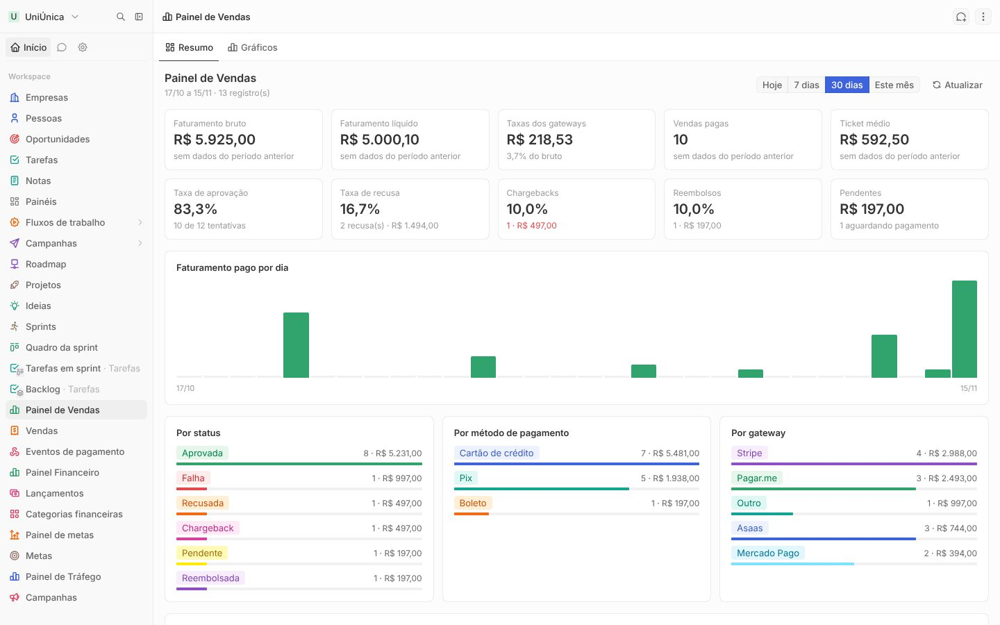

# IntegraCore — Plataforma de gestão

Sistema interno da IntegraCore para roadmap, projetos, ideias, sprints, vendas, financeiro, metas,
tráfego, wiki, quadros e alertas — tudo em um lugar só.

O produto é dividido em duas partes:

- **Motor** (`integra-core/`): servidor, banco, filas, API, autenticação, interface base e o
  executor de funções. É a parte que roda em Docker e recebe a marca da IntegraCore no build da
  imagem (ver `infra/branding/`).
- **App** (`apps/integracore/`): os módulos do produto (objetos, telas, funções, testes e README de
  cada um), publicados sobre o motor pela CLI. É onde se programa no dia a dia.

O motor fica intacto; tudo que é funcionalidade vive no app. Assim o motor pode ser atualizado sem
perder as nossas mudanças.



## Módulos

| Módulo | O que faz | Detalhes |
|---|---|---|
| **Projetos** | Roadmap em linha do tempo, Kanban de projetos, Ideias com votação e "transformar em projeto" | [README](apps/integracore/src/modules/projetos/README.md) |
| **Sprints** | Sprints com burndown, quadro da sprint, código automático nas tarefas (UNI-42), integração com GitHub | [README](apps/integracore/src/modules/sprints/README.md) |
| **Vendas** | Recebe vendas, recusas, falhas, chargebacks e reembolsos (genérico, Stripe, Mercado Pago, Asaas, Pagar.me) + painel | [README](apps/integracore/src/modules/vendas/README.md) |
| **Financeiro** | Lançamentos, categorias, recorrências, fluxo de caixa, DRE, orçado x realizado; venda aprovada vira entrada sozinha | [README](apps/integracore/src/modules/financeiro/README.md) |
| **Metas** | OKRs com progresso e status automáticos (faturamento, vendas, chargeback, leads…) | [README](apps/integracore/src/modules/metas/README.md) |
| **Tráfego** | Campanhas, métricas diárias, pixel do site, ingestão de dados, Meta Ads, CPA e ROAS cruzando com vendas | [README](apps/integracore/src/modules/trafego/README.md) |
| **Wiki** | Documentos em árvore com busca e modelos prontos | [README](apps/integracore/src/modules/docs/README.md) |
| **Quadros** | Quadro branco com formas, diagramas, histórico e IA que desenha | [README](apps/integracore/src/modules/quadros/README.md) |
| **Cofre** | Senhas e acessos guardados criptografados, com senha própria | [README](apps/integracore/src/modules/cofre/README.md) |
| **Alertas** | Regras ("chargeback > 1%", "faturamento do dia < X") enviadas para Slack, Discord, WhatsApp ou webhook | [README](apps/integracore/src/modules/avisos/README.md) |

Telas de todos os módulos: [`docs/telas/`](docs/telas).

## Estrutura do repositório

```
apps/integracore/     App com todos os módulos (é aqui que se programa)
  src/modules/<mod>/  Um módulo por pasta (objetos, telas, funções, testes, README)
infra/                docker-compose do motor (+ HTTPS para produção) e o build da marca
scripts/              apply, backup, restore
integra-core/         Código-fonte do motor, versão fixada — só referência
docs/                 Contrato entre módulos e telas
```

Regras para criar e mudar módulos: [docs/CONTRATO-MODULOS.md](docs/CONTRATO-MODULOS.md).

## Instalação (servidor novo)

Pré-requisitos: Linux com Docker e Docker Compose. Recomendado 4 vCPU, 8–16 GB de RAM, SSD.

```bash
git clone <url-deste-repo> integracore && cd integracore

# 1. Configurar e subir o sistema (a imagem é construída aqui, com a marca)
cd infra
cp .env.example .env
#   edite o .env: PG_DATABASE_PASSWORD (openssl rand -hex 32),
#   ENCRYPTION_KEY (openssl rand -base64 32) e SERVER_URL (ex.: https://gestao.suaempresa.com.br)
docker compose up -d --build            # local / rede interna
# produção com HTTPS automático: defina DOMINIO no .env e use
# docker compose -f docker-compose.yml -f docker-compose.prod.yml up -d --build
cd ..
```

2. Abra o `SERVER_URL` no navegador, crie a conta e o workspace.
   Em **Configurações → Experiência** escolha o idioma **Português (Brasil)**.
3. Em **Configurações → Desenvolvedores**, crie uma chave de API (papel **Admin**).
4. Instale o app (precisa de Node.js 24+ na máquina de onde você instala):

```bash
cd apps/integracore
corepack enable && yarn install
yarn integra auth login --url <SERVER_URL>                  # ou: echo "$CHAVE" | yarn integra auth login --with-token --url <SERVER_URL>
yarn integra app apply --create --no-input
```

5. Carregue os dados iniciais (só as categorias financeiras padrão; o app não instala dados de exemplo):

```bash
curl -X POST -H "Authorization: Bearer $CHAVE" <SERVER_URL>/s/integracore/dados-iniciais
```

Pode rodar de novo sem medo: não duplica nada.

## Configurar integrações

As chaves ficam em **Configurações → Aplicativos** (aba Instalado) **→ IntegraCore**, ou via API (veja o AGENTS.md).
Cada integração só liga quando a variável dela é preenchida (sem ela o endpoint recusa).

| Integração | Variáveis | Endpoint |
|---|---|---|
| Vendas (formato genérico, sua página atual) | — (usa chave de API) | `POST /s/vendas/webhook/generico` |
| Stripe | `STRIPE_WEBHOOK_SECRET` | `POST /s/vendas/webhook/stripe` |
| Mercado Pago | `MERCADO_PAGO_ACCESS_TOKEN` (+ `MERCADO_PAGO_WEBHOOK_SECRET`) | `POST /s/vendas/webhook/mercado-pago` |
| Asaas | `ASAAS_WEBHOOK_TOKEN` | `POST /s/vendas/webhook/asaas` |
| Pagar.me | `PAGARME_WEBHOOK_TOKEN` | `POST /s/vendas/webhook/pagarme?token=…` |
| Tráfego (ingestão / Google Ads Script) | `TRAFEGO_INGEST_TOKEN` | ver README do Tráfego |
| Meta Ads (puxa sozinho todo dia) | `META_ADS_ACCESS_TOKEN`, `META_ADS_ACCOUNT_ID` | — |
| GitHub (tarefas andam com os PRs) | `GITHUB_WEBHOOK_SECRET` | ver README de Sprints |
| WhatsApp nos alertas | `WHATSAPP_API_URL`, `WHATSAPP_API_TOKEN`, `WHATSAPP_AUTH_HEADER` | — |

Os webhooks precisam que o servidor seja acessível pela internet (domínio com HTTPS, ou Cloudflare Tunnel).

## Desenvolvimento

```bash
source scripts/dev-env.sh        # Node 24 + yarn 4 (se necessário no seu ambiente)
cd apps/integracore
yarn typecheck && yarn lint && yarn test:unit
../../scripts/apply.sh           # sincroniza o app com o servidor ativo
```

- Novas entidades: `yarn integra app add object|field|logic-function|front-component` e depois mova
  o arquivo para a pasta do módulo. Guia completo: `integra-core/packages/integracore-agent-skills/`.
- Para ver uma mudança: rode `scripts/apply.sh` e recarregue o navegador.

## Operação

- **Backup**: `scripts/backup.sh /caminho/backups` (banco + arquivos; guarda 14 dias). Agende no cron
  do servidor e copie para fora da máquina.
- **Restaurar**: `scripts/restore.sh backups/db-….dump backups/arquivos-….tar.gz`.
- **Atualizar o motor**: troque `TAG` no `infra/.env`, a pasta `integra-core/` e as versões de
  `integra-sdk`, `integra-client-sdk` e `integra-ui` em `apps/integracore/package.json` para a mesma
  versão; `docker compose up -d --build`, depois `yarn integra app apply`. Faça backup antes.

## Limitações conhecidas

- **Testado ao vivo:** webhooks genérico, Stripe, Asaas, Pagar.me e GitHub; pixel e ingestão de tráfego;
  as automações entre módulos (venda → lançamento, venda → campanha, tarefa → sprint/projeto); instalação do zero.
- **Não testado com conta real:** Mercado Pago (exige consultar a API deles) e a sincronização do Meta Ads.
- **Rotinas agendadas** (recorrências, metas de hora em hora, burndown diário, alertas a cada 15 min):
  a lógica foi testada, mas não as vimos disparar sozinhas no horário.
- Metas automáticas atualizam de hora em hora (ou na hora, quando a meta é editada), não a cada venda.
- Tema escuro e celular não foram revisados.
- Os gráficos nativos mostram o nome do mês em inglês.
